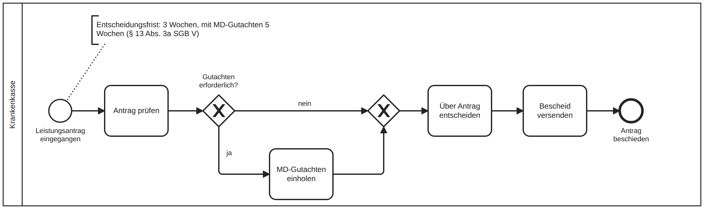
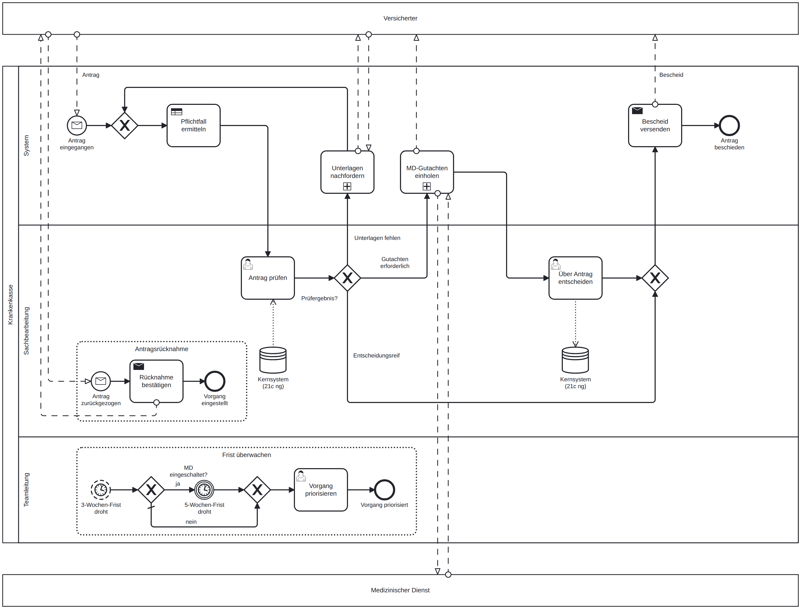
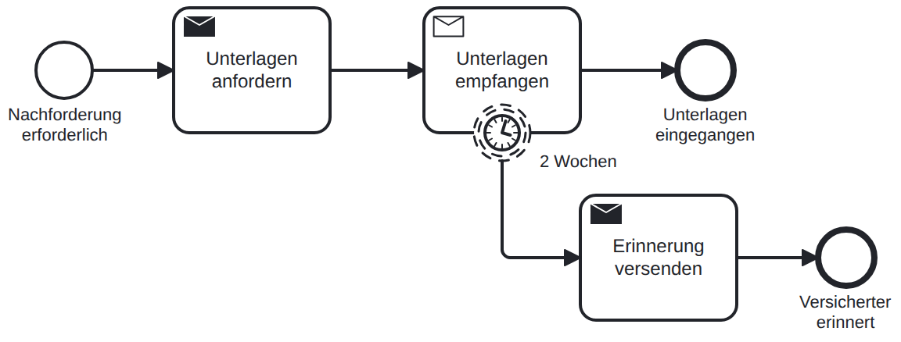
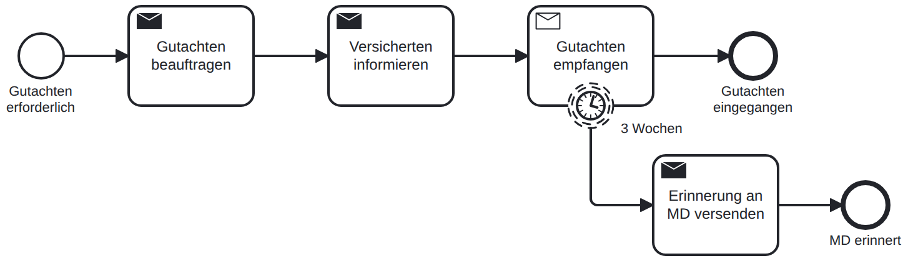
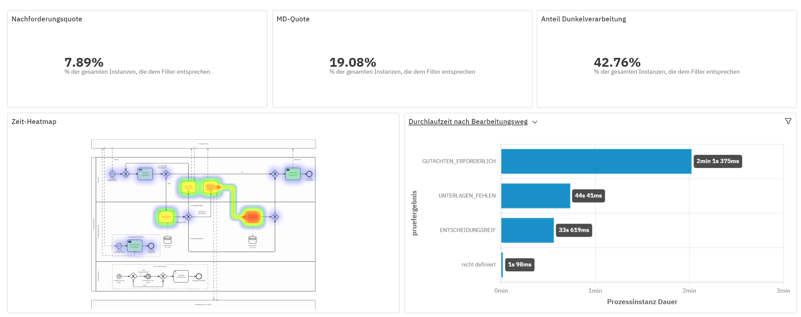

# Digitaler Leistungsantrag in der GKV (BPMN 2.0 / Camunda 8)

In diesem Projekt habe ich mir angeschaut, wie ein Leistungsantrag bei einer Krankenkasse bearbeitet wird, und den Ablauf mit BPMN neu gedacht. Ausgangspunkt war die Frage, wie man so einen Prozess digitalisieren kann, ohne dass die Fachlichkeit auf der Strecke bleibt.

Spannend fand ich vor allem die gesetzlichen Fristen. Nach § 13 Abs. 3a SGB V muss die Kasse innerhalb von drei Wochen entscheiden, mit Gutachten des Medizinischen Dienstes innerhalb von fünf. Wird die Frist ohne Begründung überschritten, gilt die Leistung als genehmigt. Ein Prozess, der Fristen nicht im Blick hat, ist hier also ein echtes Risiko.

## Projektstand

- [x] Ist-Prozess modelliert und Schwachstellen analysiert
- [x] Soll-Prozess entworfen (strategisch und operativ)
- [x] Prozess in Camunda 8 ausführbar gemacht (Formulare, Entscheidungstabelle, Nachrichten) und getestet
- [x] Dunkelverarbeitung eindeutiger Standardfälle
- [x] Auswertung mit simulierten Testdaten (Camunda Optimize)
- [ ] Automatisierte Prozesstests

## Ist-Prozess

So läuft die Bearbeitung typischerweise ab, wenn noch viel auf Papier passiert: Der Antrag kommt per Post, wird gescannt, geprüft, bei Bedarf geht er zum Medizinischen Dienst, dann wird entschieden.

Beim Modellieren sind mir vor allem diese Punkte aufgefallen:

- Niemand überwacht die Entscheidungsfrist.
- Wird der Medizinische Dienst eingeschaltet, erfährt der Versicherte davon nichts. Dadurch gilt eigentlich weiter die kürzere Frist.
- Auf fehlende Unterlagen oder das Gutachten wird gewartet, ohne nachzuhaken.
- Jede Nachreichung läuft wieder über Post und Scanner.
- Ob ein Gutachten nötig ist, entscheidet jeder Sachbearbeiter für sich.
- Bescheide werden von Hand erstellt.

## Soll-Prozess

### Überblick

Die grobe Sicht für alle, die nur wissen wollen, was passiert, nicht wie.

### Detaillierter Ablauf

Alles in der Lane „System“ übernimmt die Process Engine, Menschen kommen nur dort ins Spiel, wo wirklich eine fachliche Einschätzung gebraucht wird. Die beiden Kommunikationsschleifen habe ich in Unterprozesse ausgelagert, damit das Hauptmodell lesbar bleibt:

### Was sich gegenüber dem Ist-Prozess ändert

| Problem im Ist-Prozess | Lösung im Soll-Prozess |
|---|---|
| Frist wird nicht überwacht | Die Frist wird aus dem Eingangsdatum berechnet. Kurz vor Ablauf meldet sich die Teamleitung, bei MD-Beteiligung erst vor der verlängerten 5-Wochen-Frist |
| Versicherter wird bei MD-Gutachten nicht informiert | Direkt nach dem Gutachtenauftrag geht automatisch eine Information raus |
| Warten ohne Nachhaken | Nach 14 bzw. 21 Tagen wird automatisch erinnert |
| Post und Scannen | Der Antrag kommt digital rein |
| Gutachtenbedarf uneinheitlich | Gesetzliche Pflichtfälle erkennt eine Entscheidungstabelle (DMN), alle anderen Fälle prüft weiterhin ein Sachbearbeiter |
| Bescheide von Hand | Der Bescheid wird automatisch aus einer Vorlage erzeugt |
| Jeder Antrag landet beim Sachbearbeiter | Eindeutige Standardfälle bewilligt das System selbst (Dunkelverarbeitung) |

Eine Sache war mir beim Gutachten wichtig: Das System kann nur sicher sagen, wann ein Gutachten **gesetzlich vorgeschrieben** ist. Ob es darüber hinaus nötig ist (§ 275 Abs. 1 SGB V), ist eine Ermessensfrage. Deshalb entscheidet das System hier nie „kein Gutachten“, sondern legt diese Fälle dem Sachbearbeiter vor. Wählt der Sachbearbeiter bei einem Pflichtfall trotzdem den Weg ohne Gutachten, bleibt der Prozess mit einem Fehler stehen, statt einen falschen Bescheid zu verschicken.

### Was ich nach dem ersten Testlauf geändert habe

Beim Durchspielen in Camunda ist mir aufgefallen, dass derselbe Sachbearbeiter den Antrag ohne Gutachten zweimal hintereinander angefasst hat: erst prüfen, dann entscheiden. Jetzt entscheidet er in solchen Fällen direkt bei der Prüfung. Ein eigener Entscheidungsschritt bleibt nur dort, wo ein Gutachten neue Informationen bringt.

Außerdem war die Fristwarnung anfangs ein fester Testwert. Jetzt wird sie aus dem Eingangsdatum berechnet und berücksichtigt die verlängerte Frist bei MD-Beteiligung.

### Dunkelverarbeitung

Im letzten Schritt habe ich eindeutige Standardfälle automatisiert: Ein Hilfsmittel mit ärztlicher Verordnung bis 500 € bewilligt das System ohne Sachbearbeiter. Rechtlich ist das nach § 31a SGB X möglich, solange kein Anlass besteht, den Einzelfall von einem Menschen bearbeiten zu lassen. Wichtig war mir dabei: Das System **bewilligt nur**, es lehnt nie automatisch ab. Alles, was nicht eindeutig ist, landet weiterhin bei der Sachbearbeitung.

## Auswertung

Um zu sehen, ob die Optimierungen wirken, habe ich mit einem kleinen Python-Skript ([`tools/testdaten_generator.py`](tools/testdaten_generator.py)) 150 zufällige Anträge erzeugt und den Prozess automatisch durchlaufen lassen. Das Skript übernimmt dabei die Rollen von Versicherten, Sachbearbeitung und Medizinischem Dienst. Die Zeiten laufen im Zeitraffer: Eine Sekunde entspricht einem Tag.

Das Dashboard beantwortet drei Fragen:

- **Wie viel Handarbeit steckt im Prozess?** Rund 43 % der Anträge werden ohne Sachbearbeiter entschieden.
- **Wie oft sind Anträge unvollständig?** Bei etwa 8 % mussten Unterlagen nachgefordert werden, rund 19 % gingen zum Medizinischen Dienst.
- **Wo geht Zeit verloren?** Vor allem beim Warten auf das MD-Gutachten und auf nachgereichte Unterlagen, also bei Dritten und nicht in der Sachbearbeitung.

Daraus ergibt sich auch der nächste sinnvolle Schritt: nicht die Sachbearbeitung beschleunigen, sondern Nachforderungen vermeiden, zum Beispiel durch ein besseres Antragsformular.

## Ausprobieren

Alles, was in Camunda 8 läuft, liegt im Ordner [`camunda/`](camunda/): der Soll-Prozess, die Entscheidungstabelle und die Formulare. Der Ordner ist per Git Sync mit meinem Camunda-Projekt verbunden. Wer es selbst ausprobieren will, lädt die Dateien in ein Camunda-Projekt, deployt sie gemeinsam und startet den Testmodus. Testdaten sind am Startereignis hinterlegt.

Die Regeln in der Entscheidungstabelle sind bewusst vereinfacht und fiktiv. Echte Kassen arbeiten hier mit deutlich umfangreicheren Regelwerken.

## Versionsverlauf

| Version | Stand |
|---|---|
| v1 | Ist-Prozess mit Schwachstellenanalyse |
| v2 | Erster Soll-Entwurf mit Fristenlogik |
| v3 | Soll-Prozess neu strukturiert: Unterprozesse, Ereignis-Unterprozesse, Datenspeicher, strategisches Modell |
| v4 | In Camunda ausführbar gemacht: Entscheidungstabelle, Formulare, Nachrichten |
| v5 | Entscheidung bei eindeutigen Fällen direkt in der Prüfung |
| v6 | Fristen werden berechnet, inklusive Verlängerung bei MD-Beteiligung |
| v7 | Dunkelverarbeitung: eindeutige Standardfälle werden automatisch bewilligt |

Die aktuelle Version (v7) liegt in [`camunda/`](camunda/), frühere Stände in [`models/versionen/`](models/versionen/).

## Dateien

| Ordner | Inhalt |
|---|---|
| `camunda/` | Ausführbarer Soll-Prozess, Entscheidungstabelle (DMN) und Formulare, synchronisiert mit Camunda |
| `models/` | Ist-Prozess und strategisches Modell |
| `models/versionen/` | Frühere Stände des Soll-Prozesses als BPMN und Bild |
| `tools/` | Testdaten-Generator (Python) für die Auswertung |
| `docs/` | Diagrammbilder, Dashboard und Badges |

## Grenzen und Ausblick

Das Projekt bildet die Grundstruktur des Prozesses ab und ist bewusst nicht vollständig. Offen sind unter anderem die schriftliche Mitteilung an Versicherte bei nachgeforderten Unterlagen (§ 13 Abs. 3a Satz 5 SGB V), die Versagung bei fehlender Mitwirkung (§ 66 SGB I) und eine echte technische Anbindung der Sendeaufgaben. Die Auswertungen basieren auf simulierten Testdaten.

*Fiktives Lernprojekt ohne echte Daten.*
